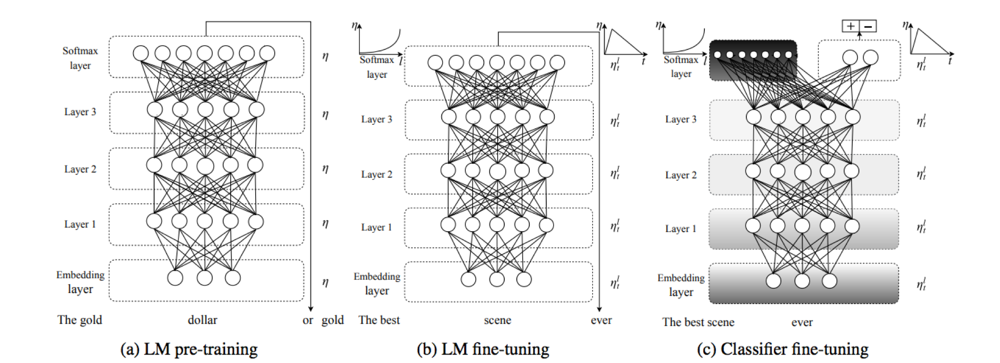
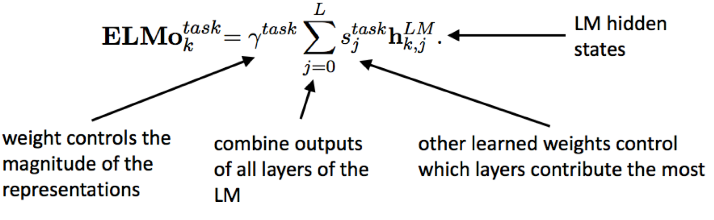
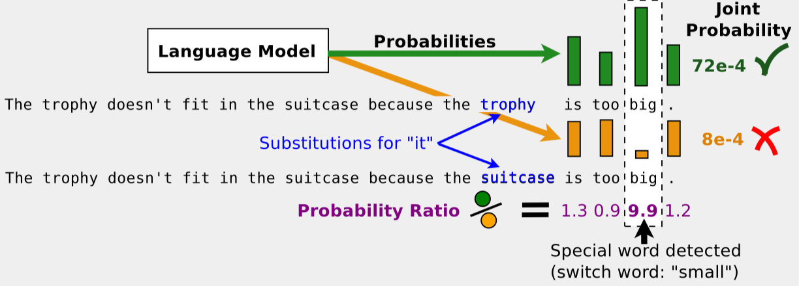

Mejora de la Comprensión del Lenguaje para Lenguajes y Tareas de Bajos Recursos con Preentrenamiento Generativo
===============================================

<strong><em>Índice</em></strong>

<!-- TOC -->

- [Autor](#author)
- [Descripción General](#overview)
    - [Resumen de la Investigación](#research-overview)
- [Experimentos](#experiments)
    - [Preentrenamiento de Modelado Generativo del Lenguaje](#generative-language-modeling-pre-training)
        - [Entrenamiento de Modelos de Lenguaje con Tensor2Tensor](#language-model-training-with-tensor2tensor)
        - [Lecciones Aprendidas](#lessons-learned)
    - [Líneas Base de Traducción Automática Neural](#neural-machine-translation-baselines)
        - [Traducción Automática No Supervisada](#unsupervised-machine-translation)
    - [Conjuntos de Datos para Modelos de Lenguaje](#language-model-datasets)
    - [Puntos de Referencia Multitarea para el Inglés](#multi-task-benchmarks-for-english)
- [Agradecimientos](#acknowledgement)

<!-- /TOC -->

Este proyecto aún está en construcción y continuará experimentando cambios importantes.

## Autor

Ali Zaidi

## Descripción General

En este proyecto examinamos la capacidad de utilizar el preentrenamiento generativo con objetivos de modelado del lenguaje en una variedad de idiomas para mejorar la comprensión del lenguaje. Se presta interés particular al aprendizaje por transferencia hacia lenguajes de bajos recursos, donde los datos etiquetados son escasos.

El preentrenamiento y el modelado generativo para una mejor comprensión del lenguaje en PLN sigue siendo un área de investigación y experimentación desafiante pero interesante. Actualmente, la mayoría de los resultados SOTA en PLN se obtienen entrenando arquitecturas de extremo a extremo para cada tarea de lenguaje. Examinamos cómo los modelos transformer que dependen únicamente de módulos de atención, así como módulos basados solo en convoluciones como Q-RNN y los descritos en QANet, pueden proporcionar representaciones ricas aprendidas a través del modelado generativo del lenguaje y luego ajustados finamente para clasificación de texto, así como para problemas multitarea generales. De interés particular será la clasificación de etiquetas de salida multi-etiqueta y jerárquica/estructurada, donde las redes convolucionales de gráficos y de valores son más efectivas que las redes de entropía cruzada categórica binaria.

### Resumen de la Investigación

En los últimos meses, se han implementado una serie de técnicas que utilizan preentrenamiento, modelado generativo, arquitecturas multitarea, aumento de datos mediante traducción inversa y técnicas de eficiencia en modelado del lenguaje, que han permitido un entrenamiento más rápido y un mayor alcance para el aprendizaje por transferencia. En particular, los siguientes artículos abordan el problema del preentrenamiento generativo y el aprendizaje multitarea en PLN y logran resultados SOTA.

1. [OpenAI: Improving Language Understanding by Generative Pre-Training](https://blog.openai.com/language-unsupervised/)
    * [código](https://github.com/openai/finetune-transformer-lm)
    * **_tldr_**: Entrenar un modelo de lenguaje no supervisado usando una arquitectura transformer y luego realizar ajuste fino en conjuntos de datos específicos para cada tarea.
2. [fastAI: Universal Language Model Fine-tuning for Text Classification](http://nlp.fast.ai/classification/2018/05/15/introducting-ulmfit.html)
    - [código](https://github.com/fastai/fastai/tree/master/fastai) 
    * **_tldr_**: Preentrenar un modelo de lenguaje en un corpus genérico de inglés (es decir, Wikipedia). Utilizarlo para inicializar un nuevo modelo de lenguaje en tu corpus específico de dominio sin etiquetas. Ajustar finamente / inicializar una nueva arquitectura específica de dominio para clasificación de texto.

    

3. [Google Brain: QANet: Combining Local Convolution with Global Self-Attention for Reading Comprehension](https://arxiv.org/pdf/1804.09541.pdf)
    - [código](https://github.com/ni9elf/QANet)
    - **_tldr_**: Entrenar un modelo de preguntas y respuestas basado en transformadores que consiste únicamente en convoluciones y autoatención. Las convoluciones modelan interacciones locales y la autoatención modela interacciones globales. Utilizar traducción inversa de Google [NMT](https://github.com/tensorflow/nmt) para aumento de datos. Actual #1 en SQuAD.
4. [AllenAI: Deep Contextualized Word Vectors](https://arxiv.org/abs/1802.05365)
    - [código](https://github.com/allenai/allennlp/blob/master/tutorials/how_to/elmo.md)
        * [implementación en tensorflow](https://github.com/allenai/bilm-tf)
    - **_tldr_**: Entrenar un modelo de lenguaje genérico utilizando Bidirectional-LSTM. 
    
5. [Salesforce Research, The Natural Language Decathlon](https://einstein.ai/research/the-natural-language-decathlon)
    - [código: github.com/salesforce/decaNLP](https://github.com/salesforce/decaNLP)
    - **_tldr_**: Desafío que consiste en diez tareas de PLN: respuesta a preguntas, traducción automática, resumen, inferencia de lenguaje natural, análisis de sentimiento, etiquetado de roles semánticos, extracción de relaciones, diálogo orientado a objetivos, generación de consultas a bases de datos y resolución de pronombres. Se propuso MQAN (red de respuesta a preguntas multitarea) que utiliza LSTM bidireccional para codificar tanto la pregunta como el documento de contexto, coatención dual, comprimida aún más usando otros dos BiLSTMs + autoatención + dos BiLSTMs más para obtener las representaciones finales.

    
6. [Trieu H. Trinh & Quoc Le: A Simple Method for Commonsense Reasoning](https://arxiv.org/abs/1806.02847)
    - **__tldr__**: Resolver preguntas difíciles de opción múltiple de _Pronoun Disambiguation Challenge_ y _Winograd Schema Challenge_ preentrenando muchos modelos de lenguaje (¡la diversidad ayuda!) y usar resolución de coreferencia para sustituir el pronombre de la pregunta con las opciones de respuesta y elegir la que tenga la mayor probabilidad (menor perplejidad) en los modelos de lenguaje (usando ensamble).
        * el modelado del lenguaje puede capturar naturalmente el conocimiento del sentido común.
    
    

## Experimentos

Describimos nuestros experimentos de modelado generativo y aprendizaje por transferencia para mejorar la comprensión del lenguaje, resumimos nuestros resultados, examinamos los problemas que enfrentamos y luego discutimos direcciones futuras.

### Preentrenamiento de Modelado Generativo del Lenguaje

Nuestros experimentos comienzan con el entrenamiento de modelos de lenguaje para una variedad de conjuntos de datos. Nuestro enfoque general es similar en todos los idiomas, por lo que discutimos nuestra implementación comenzando con el inglés.

#### Entrenamiento de Modelos de Lenguaje con Tensor2Tensor

Utilizamos el [conjunto de datos de dependencia a largo plazo de Wikipedia](https://einstein.ai/research/the-wikitext-long-term-dependency-language-modeling-dataset) curado por [Stephen Merity](https://twitter.com/Smerity/), que tiene un vocabulario de 103M de tokens en el conjunto de entrenamiento. Usamos la biblioteca `Tensor2Tensor` para entrenar este modelo, cuyos detalles se resumen en [`wikitext103-lm`](https://github.com/akzaidi/fine-lm/tree/presentation/src#language-model-training-with-tensor2tensor).

#### Lecciones Aprendidas

El entrenamiento en TPUs puede proporcionar beneficios significativos en términos de velocidad de entrenamiento. El modelo Transformer carece de cualquier operación recurrente significativa, por lo que existe una implementación optimizada en la biblioteca `tensor2tensor` que puede utilizar TPUs. Otros tipos de modelos de lenguaje, como las LSTMs bidireccionales con atención, tienen operaciones que aún no están disponibles en TPUs. 

Los TPUs aún no admiten la búsqueda de hiperparámetros basada en `cloud_ml`, por lo que tendrás que recurrir a las GPUs para su uso. El uso de múltiples TPUs para el entrenamiento de un solo modelo tampoco está soportado.

Tardó 12 horas en entrenar hasta 20K pasos, alcanzando una perplejidad de 53.2, muy cercana a la [perplejidad SOTA reportada](https://arxiv.org/pdf/1708.02182.pdf) para este conjunto de datos.

**TODO**: Probar el [transformador universal](https://github.com/tensorflow/tensor2tensor/blob/master/tensor2tensor/models/research/universal_transformer.py).

### Líneas Base de Traducción Automática Neural

#### Traducción Automática No Supervisada

Aquí replicamos el artículo [Unsupervised Machine Translation Using Monolingual Corpora Only](https://arxiv.org/abs/1711.00043) utilizando `OpenNMT-tf`. Esta implementación no funcionó en TPUs, por lo que en su lugar usamos 4 V100 para el entrenamiento.

### Conjuntos de Datos para Modelos de Lenguaje

- [**Inglés**, Conjunto de Datos Penn Tree Bank](https://catalog.ldc.upenn.edu/ldc99t42)
- [**Inglés**, Conjunto de datos de dependencia a largo plazo Wikitext](https://einstein.ai/research/the-wikitext-long-term-dependency-language-modeling-dataset)

### Puntos de Referencia Multitarea para el Inglés

El conjunto de datos específico para la tarea que examinaremos es un corpus de artículos científicos de PubMed, recopilado y distribuido por el NLM y el desafío [BioASQ](http://bioasq.org/).

- 14 millones de resúmenes, títulos y etiquetas MeSH (Medical Subject Headings)
- jerarquía de encabezados de etiquetas de padre a hijo

## Agradecimientos

Este proyecto fue apoyado por [Deep Learning Camp Jeju 2018](http://jeju.dlcamp.org/2018/) organizado por el [TensorFlow Korea User Group](https://facebook.com/groups/TensorFlowKR/). También quiero agradecer a mi maravilloso mentor, [Minjoon Seo](https://seominjoon.github.io/), por sus consejos e inspiración. Por último, muchas gracias a todos los participantes por hacer de esto una experiencia súper divertida!

